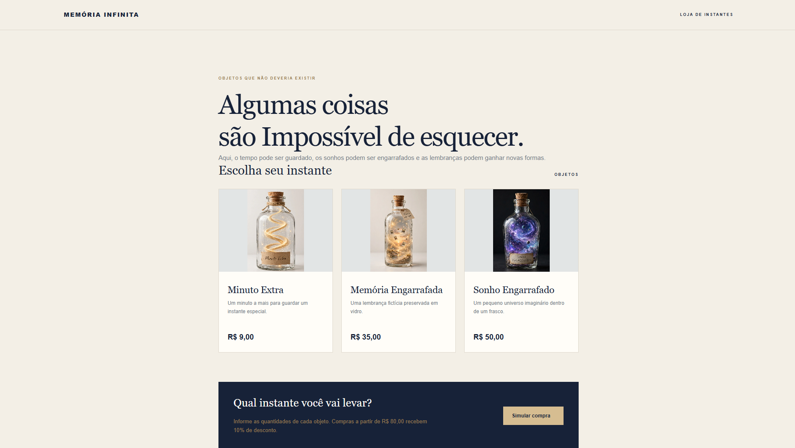
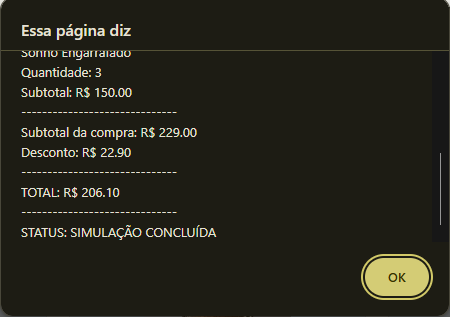

# Memória Infinita — Loja de Instantes

**Aluno:** EUDERLAN FREIRE DA SILVA ABREU
**Trilha:** DESENVOLVIMENTO MOBILE

## Apresentação

A Memória Infinita é uma loja fictícia de conceito surrealista
que comercializa objetos imaginários relacionados ao tempo,
às lembranças e aos sonhos. 
Eu tive essa ideia porque queria algo mais minha cara. 
Gosto de criar 

## Produtos

- Minuto Extra — R$ 9,00
- Memória Engarrafada — R$ 35,00
- Sonho Engarrafado — R$ 50,00

Compras com subtotal igual ou superior a R$ 80,00
recebem 10% de desconto.

## Tecnologias

- HTML
- CSS
- JavaScript

## Como executar

1. Baixe ou clone este repositório.
2. Abra a pasta do projeto.
3. Abra o arquivo index.html no navegador.
4. Clique em "Comprar".
5. Informe as quantidades solicitadas.

## Captura de tela

## Testes realizados

## Dificuldade encontrada e aprendizado

Durante o desenvolvimento do projeto, tive algumas dificuldades principalmente na parte do CSS, pois precisei ajustar o posicionamento dos elementos, as cores, os espaçamentos e a organização das telas para deixar a loja com uma aparência mais bonita e organizada. Também encontrei um pouco de dificuldade no script.js, especialmente na lógica da simulação de compra, no cálculo dos valores e na aplicação do desconto. Porém, com pesquisas, testes e ajustes no código, consegui resolver os problemas e compreender melhor como funciona a integração entre HTML, CSS e JavaScript.

## Uso de inteligência artificial

A utilização de IA foi feita para auxiliar na construção do desing do front-end para que eu consigo fazer o HTML por cima.
Depois Aplicar o CSS e por fim as Interações com JavaScript para Simular a compra. Além de Criar as imagem ilustrativas das garrafas.